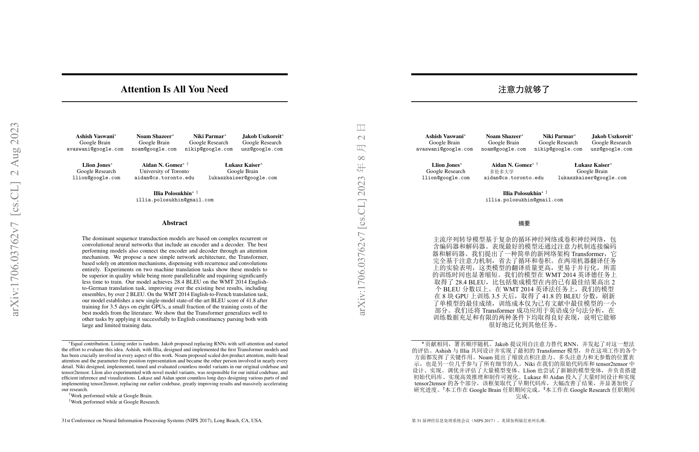

# Immersive Translate for Codex

在桌面端的 ChatGPT / Codex 中直接使用沉浸式翻译文档！保留原有格式的情况下对文档进行翻译，翻译由当前 Codex 对话完成，使用该对话的模型和额度。排版在本机由代码执行，无需配置 API Key、启动服务或安装本地大模型。

| 支持输入 | 双语文件 |
| --- | --- |
| Word（`.docx`、`.doc`）、`.txt`、`.md` | 译段紧跟原段并继承样式。表格在同一单元格内追加译文。图片、公式和超链接保留。 |
| `.pdf` | 每页向右扩为两倍宽度，左边呈现原页，右边以相同格式呈现译文。保留图像、公式和可定位的超链接。 |

以翻译《Attention Is All You Need》为例，使用 GPT-6.2 Sol 模型和 Ultra 推理强度，Plus 账户翻译耗时 5 分零 1 秒，使用了 5 小时用量的 6%。

## 安装和使用

Python >= 3.11

克隆这个项目 `git clone https://github.com/cremecho/Immersive-Translate-for-Codex.git`

安装依赖 `pip install -r requirements.txt`

在 Codex 中安装技能 `请安装当前项目中的 skill/immersive-translate-local 技能，并将入口设为当前项目的 translate.py。`

在对话中上传文档，并使用提示词**保留排版翻译** 或 **沉浸式翻译**，即可在项目的output文件夹中得到双语对照文档。你也可以说「保留排版翻译，译成英文」，来中译英，或使用其他提示词进行小语种翻译。

桌面翻译自动在工作区 `output/格式/` 下生成 `原名-zh-CN-dual.扩展名`。

## 实现与开源来源

对照样例时，Word 的译文是紧邻原段的独立段落，两段之间常见 6 磅间距。PDF 样例由 BabelDOC 生成。以下项目分别用于比较双语排版做法及实际处理文档。

| 任务 | 对照的翻译实现 | 本项目直接调用的开源代码 |
| --- | --- | --- |
| Word | [DocuFluent 双语重建](https://github.com/LingyiChen-AI/DocuFluent/blob/main/reconstruct_bilingual.py)、[docx-translator](https://github.com/bitic/docx-translator/blob/main/translate_docx.py) | [python-docx 的 OOXML 文本节点](https://github.com/python-openxml/python-docx/blob/master/src/docx/oxml/text/run.py) 和 [lxml](https://github.com/lxml/lxml) 读取段落、复制样式和写入文本。保留原 ZIP 中未修改部件的内容。 |
| Markdown | [md-translator 的 Markdown 保护机制](https://github.com/rockbenben/md-translator) | [markdown-it-py](https://github.com/executablebooks/markdown-it-py) 提供 CommonMark 语法、表格解析、链接规则和源行映射。程序在原文位置插入译文。 |
| PDF | [BabelDOC 的并排页面合成](https://github.com/funstory-ai/BabelDOC/blob/main/babeldoc/format/pdf/document_il/backend/pdf_creater.py)、[PDFMathTranslate](https://github.com/PDFMathTranslate/PDFMathTranslate) | [PyMuPDF](https://github.com/pymupdf/PyMuPDF) 提供文字与坐标提取、选择性移除文字、文字框排版、字体子集及矢量页面合成。 |

本项目补充了段落级格式标记、原译配对、图片保留规则和 Codex 分批回填。SQLite 保存译文，构建时检查原件指纹与译文完整性。本地依赖保留上游许可证。PyMuPDF 使用其 [AGPL 或商业许可](https://github.com/pymupdf/PyMuPDF#license-and-copyright)。

与当前对话交接译文的设计还对照了两种做法：[paper-pdf-translator](https://github.com/minjunnzheng/paper-pdf-translator) 用已登录的 Codex CLI 接收 BabelDOC 翻译请求，[translate-academic-pdf](https://github.com/Yongjian-Wang6/translate-academic-pdf#auditable-reviewed-workflow) 支持导出原文段、校订后回填。本项目让桌面端一次领取整篇的文本包，在当前对话内并行翻译，避免为每次翻译请求单独启动 CLI。

## 一次翻译如何执行

1. `start` 校验原件并提取段落。PDF 优先使用结构树与文字坐标识别表格单元格，将可重排的段落、参考文献与受保护的公式标记整理为待译文本。程序按文本量平衡各组，并复用位置和内容匹配的重复页眉。每个文本包对应一个独立答案文件。
2. 当前 Codex 对话和可用子代理按组翻译。模型每包读取一次原文和必要上下文，按顺序写入译文数组。程序用包标识、条数和格式标记校验，原有段号式答案继续可用。
3. `finish` 汇总答案、检查遗漏与标记、生成双语文件并核验。PDF 检查页宽、页数、左侧原貌、右侧译文框与图片，并根据译侧实际字形重建可定位的链接。`ready` 表示可直接交付；`review` 会列出需要核对的具体位置。链接和数学重排等提示保存在 `verification.json`。输入和已核验的成品都相同时，重复交付可直接复用。

正常翻译只需这两个程序入口。桌面端仍然使用原来的两个提示词。

PDF 中的插图连同内部标签保留原貌。正文中的图题、图注和独立表格仍翻译。若文本包中混入需要原样保留的图内标签，可对该段显式填写 JSON `null`；遗漏段号仍会报错。该规则同样适用于难以解码的图内字形。
